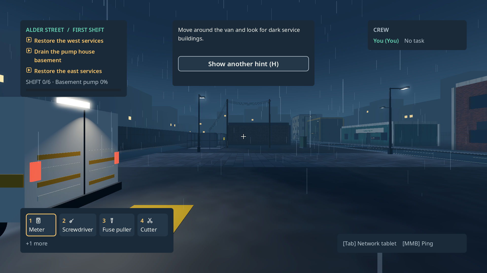
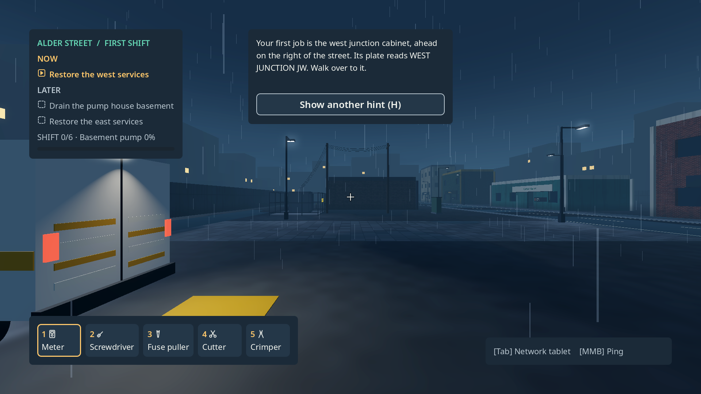
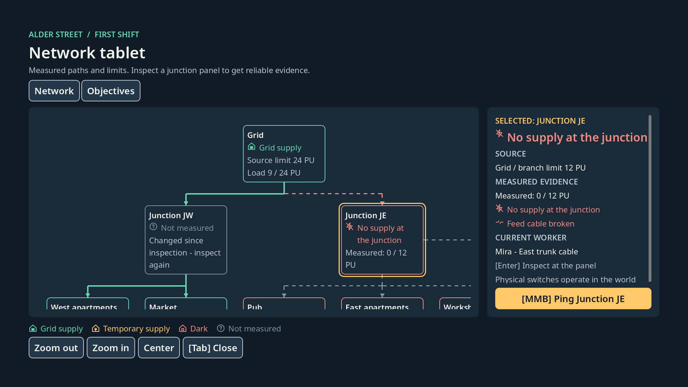
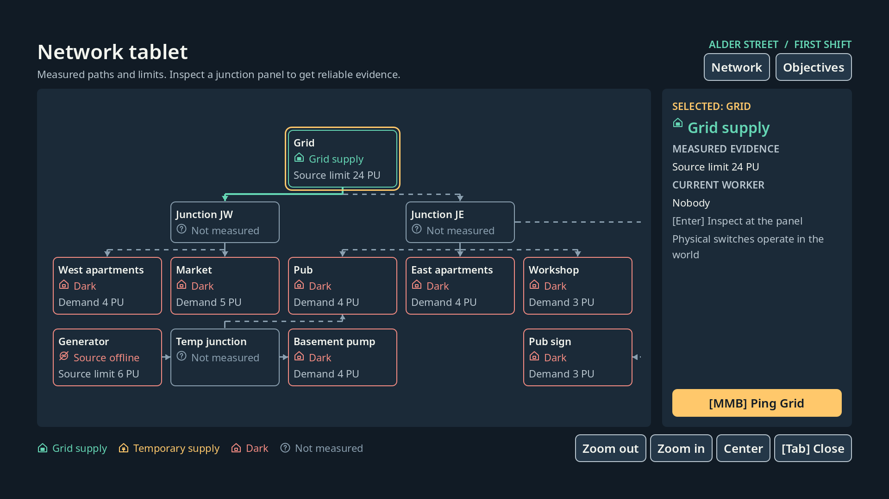
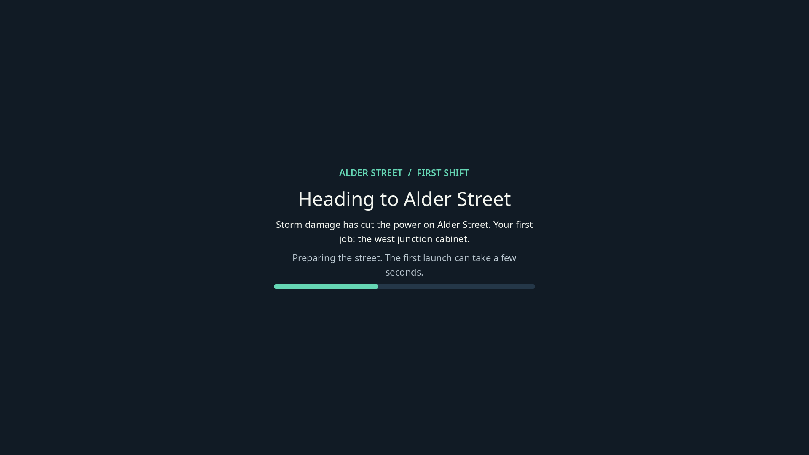

# Evidence: DS09 First-minute clarity

- Status claimed: **DONE** in the design workstream (`docs/design/quality-workstream.json`). The Intel UHD meets ADR-017's 14 ms on the
  mission mean at the Auto default (11.1-11.7 ms); its harness P95 (33-38 ms) is inflated by frame pacing as in DS08 and is recorded, not
  rounded. No backlog status changes (ADR-017 decision 5).
- Date (UTC): 2026-11-09
- Branch / commit: `task/DS09-first-minute-clarity`, cut from `main` df119a1 (DS08, PR #143). Commits edfc947, 421218e, 332d6f6 and the
  evidence commit after them.
- Environment: local desktop worktree session (ADR-015) on the owner's Windows 11 PC (i9-14900HX), NVIDIA GeForce RTX 5090 Laptop GPU
  (driver 621.14), Godot 4.7.2.stable.official.ed1daf0bf, Compatibility renderer. The laptop was **on battery** for the
  screenshots, contrast and first-reading runs, and **on AC power** for the QA140 runs (the owner plugged it in and approved the Intel GPU
  preference on request); see "Finding: battery". Intel: RaptorLake-S Mobile Graphics (UHD, driver 32.0.101.7092).
- Content revision: changes with this task (`content/accessibility.json`, `content/world/shader_warmup.json`, strings, tokens).

## What the task required
From the quality workstream and the design-overhaul brief (owner decisions 9 Nov 2026):
0. 3D resolution setting (100 / 85 / 75 / 50 %, bilinear) in Settings with focus/controller support, persisted with the preferences (no
   save migration); its default keeps the Intel UHD at native 2560x1600 within ADR-017's 14 ms.
1. Shader/material warm-up behind the loading card so the cold-cache first mission frame (3.4 s Intel, 4.7 s RTX in DS08) never stalls a
   visible frame.
2. Onboarding names the first target (west junction cabinet, plate WEST JUNCTION JW) without revealing the repair; objective card Now/Later;
   crew row "You (You)" fixed and hidden in solo; all five tools on the bar at 100 % on 1920x1080; tablet opens with every consumer visible at
   body text size; `unknown` token at least 5:1 on the panel; HUD contrast all probes AA; scripted time-to-first-meter-reading on the export
   (a target, not a fact); QA140 P95 + mean on the Intel UHD.

## What was built
- **3D resolution** (`scripts/ui/accessibility_settings.gd`, `scripts/ui/accessibility_panel.gd`, `content/accessibility.json`): a toggle-button
  row (Auto / 100 / 85 / 75 / 50 %) in Settings (the screen is now titled "Settings"; the pause button too), keyboard and controller focusable,
  stored as `render_scale_percent` with the other preferences. Older profiles without the key read Auto (`ADDED_KEYS`), so no migration.
  `apply_render_scale` sets `SCALING_3D_MODE_BILINEAR` and the scale on the root viewport; the mission applies it on start and on every
  settings change. **Default Auto** = largest option whose 3D pixel count is at most 1920x1200: 75 % on the Intel laptop's 2560x1600,
  100 % at 1080p/1200p (ADR-017 amendment DS09).
- **Shader warm-up** (`scripts/world/shader_warmup.gd`, `content/world/shader_warmup.json`): after the mission builds, the player camera tours
  the spawn and every local light (deduplicated by 12 m spacing, at most 16 vantages, 4 headings each, one view per frame) behind an opaque
  loading card (`scripts/ui/loading_card.gd`, shared with the main menu so the hand-over is one unchanged picture, with a progress bar). Input,
  physics and the onboarding idle timer are gated while it runs. Headless runs skip it. The menu card and the mission card are the same
  build (test below).
- **Onboarding** (`content/ui/strings/en.json`, `scripts/ui/onboarding_guide.gd`): the loading card's briefing and the first two steps name
  the west junction cabinet and its plate ("WEST JUNCTION JW") and say where it is ("ahead on the right of the street"); the measure step shows
  the live bindings for the current device ("Equip the meter (1) ... press E" on keyboard and mouse). Pillar 1: it names the cabinet, never the fuse or breaker.
- **Objective card** (`scripts/ui/hud_presenter.gd`, `scripts/ui/field_hud.gd`): the first active objective is under NOW, the rest under LATER
  with the pending icon; the host list is not mutated.
- **Crew card**: hidden when solo; "(You)" is not appended to a name that already is "You".
- **Tool bar**: five slots (every C01 tool, the crimper no longer behind "+1 more"). The compact bar (150 %, tight screens) stacks number over
  icon so five slots end before the prompt (ADR-004 addendum DS09).
- **Tablet** (`scripts/ui/network_tablet.gd`, `tablet_map.gd`, `tablet_node.gd`): tighter node grid and gaps, a narrower evidence column,
  header and footer as wrapping flows, unmeasured nodes show one line on the map. The whole C01 network fits at zoom 1.0 at 1920x1080 with
  body text.
- **`unknown` token** `#8A9FAF`: 5.34:1 on panel (was 4.59:1) (ADR-004 addendum DS09).
- **First-reading driver** (`scripts/diagnostics/ds09_first_reading_driver.gd`, `--ds09-first-reading`, internal exports and editor only): presses
  Start, waits until the mission is playable (warm-up over), walks and turns with the normal input actions to the west junction panel the way
  the onboarding text describes, taps tool slot 1 and Interact, and waits until the guide leaves the measure step. Writes
  `user://ds09/first_reading.json`. It is a bot that knows the way, so its time is a floor for a person, not a playtest result.
- **QA140 driver**: waits for the warm-up (step `shader_warmup_done`) and reports the warm-up stats.

## What was run
| Step | Command | Result |
|---|---|---|
| Full suite, fresh APPDATA | `APPDATA=<new scratch dir> bash tools/run_tests.sh` | **502 passed, 0 failed**, 10009 assertions; C01 solution trace solved; Python/Godot hashes match; ALL CHECKS PASSED |
| DS09 tests | `bash tools/run_tests.sh --filter=DS09` | 15 passed (`tests/integration/test_DS09_first_minute.gd`) |
| Token contrast | `python tools/check_contrast.py` | 44 checks, 0 failures |
| Screenshots 1920x1080 | scratch SceneTree script (real host state, no fakes) on the RTX 5090 | `docs/evidence/img/DS09_after_*.png` |
| HUD contrast | `godot --path . --resolution 1920x1080 -s tools/godot/capture_hud.gd -- --out-dir=<scratch>` | **CONTRAST PASS: 270 probes, 0 below AA** (RTX 5090); `DS09/DS09_hud_contrast.json` |
| Internal export | `"$GODOT_BIN" --headless --path . --export-release "Windows Desktop (internal)" <scratch>/build/LightsBackOn.exe` | exit 0 |
| First reading, export | `LightsBackOn.exe --resolution 1920x1080 -- --ds09-first-reading`, fresh APPDATA, run twice (cold, then warm Godot shader cache) | ok both (table below) |
| QA140, RTX sanity (battery) | `LightsBackOn.exe --log-file <run>\godot.log --fullscreen --disable-vsync -- --qa56-capture --qa56-id=<32 hex> --qa140-scenario` | ran (exit 0), **discarded**: battery (below) |
| QA140, Intel cold (AC) | same args through a scratch PowerShell runner (renderer args as one string, 3 s Windows memory samples), fresh APPDATA, HKCU `UserGpuPreferences` = `GpuPreference=1;` for the scratch exe | exit 0, 180 s; `DS09/intel_gl_ds09_cold` |
| QA140, Intel warm (AC) | same, same APPDATA (what a second launch sees) | exit 0; `DS09/intel_gl_ds09_warm` |
| GPU preference removed | `Remove-ItemProperty ... UserGpuPreferences -Name <scratch exe>` | removed, checked |
| QA140, RTX sanity (AC) | same runner, default adapter, fresh APPDATA | exit 0; `DS09/rtx5090_gl_ds09_sanity` |
| Summary | `python tools/qa140_summarize.py <runs dir>` | `DS09/summary.md`, `summary.json`; raw frames.csv hashed in `DS09/frames_csv_sha256.txt` (not committed, as in QA140/DS08) |

## Observed result

### Screenshots (1920x1080, RTX 5090, host state)
| Before | After |
|---|---|
|  |  |
|  |  |
| (DS08: menu card, then the first mission frame froze 3.4-4.7 s on a cold cache) |  |

Also: `img/DS09_after_measure_step.png` (measure step names the cabinet, live bindings, NOW/LATER, five tools),
`img/DS09_after_settings_render_scale.png` (3D resolution row), `img/DS09_hud_dark_150.png`, `img/DS09_tablet_150.png` (contrast frames).

### First meter reading (bot, internal export, RTX 5090, 1920x1080, render scale 1.0, on battery)
| Run | Start to playable | Playable to reading | Start to reading | Warm-up (views / total / worst frame) |
|---|---|---|---|---|
| Cold Godot shader cache (fresh APPDATA) | 5.40 s | 11.32 s | **16.7 s** | 48 / 4.94 s / 1.56 s |
| Warm (second launch) | 0.85 s | 11.66 s | **12.5 s** | 48 / 0.53 s / 46 ms |
| Editor (earlier, for reference) | 2.46 s | 12.52 s | 15.0 s | |

The 1.56 s worst warm-up frame is behind the opaque loading card. The card was drawn on the frame before it and stays on screen, so the
player sees a still loading card, not a frozen street. After the card is gone the first visible frames are about 6 ms (editor runs).
"Playable to reading" is mostly walking: about 11 s of route at walking speed, which the bot cannot shorten. A person who reads the card and
then looks for the plate will be slower. **Target to test with people (plan DS09): first meter reading within 60 s of Start**; this bot run is
a floor, not a measure of that.

### Performance (QA140 harness, internal export, 2560x1600 fullscreen, vsync off, AC power, 3D resolution Auto)
Auto resolves to 75 % at 2560x1600 (tested in `test_DS09_first_minute.gd`; the run report does not record the scale). Mean frame = mean
main-loop interval per segment from the frame CSV, first 5 s excluded.

| Run | Mission mean frame (idle / walk / tablet / pause) | Harness P95 overall / mission worst | Max frame | >33.3 ms frames | Working set peak | GPU shared peak |
|---|---|---|---|---|---|---|
| DS08 Intel warm (reference, 100 %) | 14.1 / 13.9 / 14.7 / 14.1 ms | 41.9 / 45.0 ms | 213 ms | 2227 | 709 MiB | 541 MiB |
| DS08 Intel cold (reference) | ~14.4 ms | 42.5 / 45.7 ms | **3353 ms, visible** first mission frame | 2156 | 730 MiB | 541 MiB |
| **DS09 Intel cold** | **11.1 / 11.1 / 11.3 / 10.7 ms** | 33.3 / 35.7 ms | 839 ms, the warm-up's worst frame **behind the loading card** | 804 | 707 MiB | 462 MiB |
| **DS09 Intel warm** | **11.6 / 11.3 / 11.7 / 11.2 ms** | 33.9 / 37.8 ms | 131 ms | 902 | 699 MiB | 528 MiB |
| DS09 RTX 5090 sanity | 2.4 / 0.9 / 2.0 / 2.1 ms | 2.58 / 4.24 ms | 471 ms (warm-up, behind the card) | 5 | 396 MiB | 138 MiB (252 MiB dedicated) |

Warm-up on the Intel: 48 views from 12 vantages, 3.13 s cold (worst frame 839 ms), 0.69 s warm (worst 45 ms). Engine-reported video
memory 93.6-95.4 MiB (DS08 104.6).

- **ADR-017 guardrail "Intel UHD at most 14 ms at its native 2560x1600": met on the mean** at the default (11.1-11.7 ms per mission segment,
  about 2.5-3 ms better than DS08 at 100 %). The DS08 bench predicted 10.8 ms for 75 %.
- **Harness P95 33-38 ms is not 14 ms.** As DS08 explained, a GPU-bound Intel with vsync off lets the CPU run ahead and then block, so
  main-loop intervals alternate between short and ~33 ms frames; P95 lands on the long ones. It improved from 42-46 ms. This is recorded, not
  rounded up. A vsync-on run (the player default) was not made.
- **No visible stall over 1 s**: the cold first mission frame (DS08: 3.35 s on screen) is gone; the longest frame is inside the warm-up behind
  the opaque card.

### Finding: battery
The QA140 sanity run on the RTX (2560x1600 fullscreen, vsync off) showed overall P50 16.67 ms and P99 515 ms, against 1.45 / 3.06 ms in
DS08. The frame CSV shows 209 frames of about 500 ms spread across **every** segment, about one per second, **including the idle main menu**,
which DS09 did not change. The laptop was discharging (`PowerOnline` False). That is the Windows battery power plan throttling, not the game,
so the run is not a measurement and its numbers are not used. The first-reading times above were taken on battery too; treat them as an
upper bound. The QA140 runs above were made after the laptop was put on AC power (`PowerOnline` True).

## Not verified / pending
- Intel harness P95 is above 14 ms (above); no vsync-on Intel run.
- First-reading bot times were measured on battery; not rerun on AC.
- GTX 1650 laptop (192.168.50.2): not used (shared with another project; needs the owner's go).
- People: the onboarding copy, Now/Later and time-to-first-reading are untested with players. Controller: the Settings row was tested for
  focus order in code, not with a real pad.
- Simplified Chinese layout (font still pending, ADR-004 font addendum).

## Test changes worth knowing
- `test_V07_ui.gd` QA75/QA76/QA81 injected 70-75 evidence lines, but the tablet refuses snapshots over `MAX_TABLET_LINES` (32) and silently
  keeps the old view. They passed only because the old evidence column was tall enough. The fixtures now inject exactly 32 lines into nodes
  that may carry evidence (an unmeasured junction may only hold its one "unknown" line) and assert the snapshot was accepted.
- `test_V01_controller_targeting.gd`: the fifth tool now has its own named slot (was the "+1 more" note).
- `test_F05_tokens.gd`: `unknown` is `#8A9FAF`.

## Resume notes (for the next session)
- DS09 is complete: committed on `task/DS09-first-minute-clarity`, PR #145 into `main`, workstream DONE. The GPU preference value is removed.
- `main` with SAVE22 (PR #144, ADR-018) was merged in before merging: `content/world/shader_warmup.json` is listed as presentation-only in
  `content/save_compat.json` (read only by `scripts/world/shader_warmup.gd`). `content/accessibility.json` stays counted as rules (the
  onboarding guide and settings read it), so offline checkpoints made before DS09 are refused with CONTENT_MISMATCH and kept, never erased.
  Suite after the merge: 518 passed, 0 failed (`bash tools/run_tests.sh`, which now isolates `user://` itself).
- Next: DS10 (fault evidence in the world). Hand-over notes for DS10 are in the design-overhaul session's shared notes folder
  (`DS09-handover.md`): onboarding plate, warm-up coverage for new cabinet materials, the first-reading driver as a regression check.
- The scratch scripts (screenshots, HUD/tablet geometry dumps) were not committed; `tools/godot/capture_hud.gd` is the committed contrast tool.
